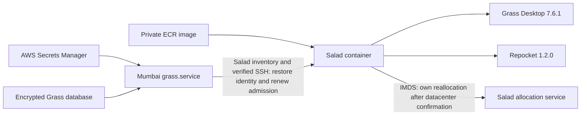

# Current Grass + Repocket runtime

The exact deployed image is
`images/grass-repocket-combined-20260913-1b52f43837f6.tar`.
It loads as `wdi-grass:combined-20260913-1b52f43837f6` with manifest digest
`sha256:1b52f43837f69529a7a0975fb54c200231b3641db54c371383de4aaa9e2c21f8`.
The source in this folder matches that runtime. `recovery.json` records the
current encrypted checkpoint, expected device identity, and required AWS secret
version. [The root README](../README.md) explains how to obtain missing assets.

## How the running system connects



The clients run on Salad, not on the EC2 server. One Mumbai controller preserves
Grass installation keys and renews admission. Grass requires that controller and a restored account. A bare `docker run` starts the
image but does not supply the Salad identity, SSH transport, account, or admission.
No Codex, browser automation, or website collector is needed to operate the apps.

The combined container has the IP policy and both byte meters inside it. It
checks its public IP every 30 seconds. A new address is classified by IPQuery;
confirmed datacenter status holds both apps and requests its own reallocation
through Salad IMDS. Unknown classification holds locally. A false datacenter flag
means “not detected as datacenter,” not proof of residential status. Classifications
for an unchanged IP are cached for an hour. There is no separate IP supervisor.

Each app has its own traced process tree. Counters measure successful TCP/UDP
socket I/O, including protocol traffic and TLS framing. They are not provider
credits or wire-level bytes. `GRASS_SAMPLE_V2`, `RP_MON`, and native policy events
are emitted to Salad logs. The website reads them but does not control admission.

## AWS access and prerequisites

| Setting | Existing value |
| --- | --- |
| AWS account / region | `163092837436` / `ap-south-1` |
| EC2 controller / instance role | `i-0c2e48a7ddc2dd010` / `mumbai-clean` |
| EC2 SSH alias | `mumbai` on the original Mac only; not a portable credential |
| Salad organization / project / group | `cosmosgeeketh` / `default` / `wdi-grass-continuity` |
| ECR repository | `163092837436.dkr.ecr.ap-south-1.amazonaws.com/grass-desktop` |
| AWS secret | `wdi/salad-access`; required versions are in `recovery.json` |
| Live source / service | `/opt/wdi/grass.py`, `/opt/wdi/session.py` / `grass.service` |
| Live identity / session | `/var/lib/wdi/grass.sqlite3`, `/var/lib/wdi/account-session.enc` |
| Group selection | `/etc/wdi/grass.env` |

Use an authorized AWS CLI login, or the existing AWS Console session. Confirm
`aws sts get-caller-identity --query Account --output text` returns the account
above. AWS Console → Systems Manager → Run Command → `AWS-RunShellScript` runs
root commands on the selected instance. The CLI equivalent is:

```sh
aws ssm send-command --region ap-south-1 \
  --instance-ids i-0c2e48a7ddc2dd010 \
  --document-name AWS-RunShellScript \
  --parameters '{"commands":["systemctl is-active grass.service","python3 /opt/wdi/grass.py --status"]}' \
  --query Command.CommandId --output text
# Substitute the returned ID:
aws ssm get-command-invocation --region ap-south-1 \
  --instance-id i-0c2e48a7ddc2dd010 --command-id COMMAND_ID
```

A replacement controller can use Ubuntu 24.04 on ARM64 or AMD64. Attach the
`mumbai-clean` instance profile and enable SSM. Its role needs
`secretsmanager:GetSecretValue` for the recorded secret versions and the ECR read
permissions in `ecr-pull-policy.json`, plus SSM instance-management permissions.
If a customer-managed KMS key protects that secret, the role also needs decrypt
permission for that key. It needs outbound HTTPS to AWS, Salad and Grass, and
outbound TCP to Salad's returned SSH host/port. No inbound website port is needed
for these apps. The container images themselves are **Linux AMD64**.

Keep the original AWS secret versions. The `ssh_private_key` field derives the
AES-GCM encryption keys for saved installations; rotating it does not decrypt old
state. The matching `ssh_public_key` must remain registered in the Salad account's
SSH Keys page. The private key and Salad API key are read only in memory on AWS.
[Salad's SSH instructions](https://docs.salad.com/container-engine/explanation/container-groups/ssh-and-terminal)
show where the account-level public key is registered.

## Load the exact image

On a Docker host, from the WDI directory:

```sh
docker load --input Grass/images/grass-repocket-combined-20260913-1b52f43837f6.tar
```

`configuration/salad-group.json` contains only current deployment settings.
The runtime credential is represented by its encrypted recovery file, not a
plaintext key. The creation command below builds the API request from it.

ECR normally already holds these exact digests. If its images were deleted, load
and push the saved images from an authorized Docker host. The operator needs ECR
upload permissions (`InitiateLayerUpload`, `UploadLayerPart`, `CompleteLayerUpload`,
`BatchCheckLayerAvailability`, `PutImage`, `GetAuthorizationToken`); repository
creation additionally needs `CreateRepository`. The controller's pull policy does
not grant upload permission. On an authorized Ubuntu Docker host, configure the
[AWS ECR credential helper](https://github.com/awslabs/amazon-ecr-credential-helper)
without a credential file cache, then run the push commands below:

```sh
apt-get install -y docker.io amazon-ecr-credential-helper
export AWS_ECR_DISABLE_CACHE=true
export DOCKER_CONFIG="$(mktemp -d)"
trap 'rm -rf "$DOCKER_CONFIG"' EXIT
printf '%s\n' '{"credHelpers":{"163092837436.dkr.ecr.ap-south-1.amazonaws.com":"ecr-login"}}' > "$DOCKER_CONFIG/config.json"
```

This configuration contains a helper name, not a password. The helper obtains
fresh credentials from the authorized AWS identity for each registry operation.

```sh
# Current combined image:
docker tag wdi-grass:combined-20260913-1b52f43837f6 \
  163092837436.dkr.ecr.ap-south-1.amazonaws.com/grass-desktop:combined-20260913-1b52f43837f6
docker push 163092837436.dkr.ecr.ap-south-1.amazonaws.com/grass-desktop:combined-20260913-1b52f43837f6
```

Confirm the pushed manifest digest matches the digest at the top of this file. ECR authentication tokens
expire after 12 hours; obtain a fresh token for a later pull/deployment. See
[AWS ECR authentication](https://docs.aws.amazon.com/AmazonECR/latest/userguide/registry_auth.html).

## Restore the controller from WDI

These are recovery commands for a missing controller, not an instruction to
replace a healthy live database with an older checkpoint. Ensure the old
controller is stopped before starting its replacement. Copy the WDI folder to
`/opt/wdi-source` on the replacement through your authenticated file-transfer
method. If using the original Mac, stage it with `rsync -az Grass Repocket
mumbai:/home/ubuntu/wdi-source/`, then copy that staging directory to
`/opt/wdi-source` through SSM. Do not copy the unrelated app folders.

Run as root on the replacement via SSM:

```sh
apt-get update
apt-get install -y python3-boto3 python3-paramiko python3-cryptography openssl
cd /opt/wdi-source
install -d -m 755 /opt/wdi
install -d -m 700 /var/lib/wdi /etc/wdi

# Current combined controller:
install -m 644 Grass/grass.py Grass/session.py /opt/wdi/

install -m 600 Grass/state/grass.sqlite3 /var/lib/wdi/grass.sqlite3
install -m 600 Grass/state/account-session.enc /var/lib/wdi/account-session.enc
install -m 600 Grass/configuration/grass.env /etc/wdi/grass.env
install -m 644 Grass/grass.service /etc/systemd/system/grass.service
systemctl daemon-reload
```

Do not run `--initialize` during a restore. The saved database already has the
installation keys. Do not run two controllers with copies of the same database.
On a new host, lease recovery deliberately waits for old admission to expire
before reusing an identity; an initial pause of several minutes can be expected.

## Restore the Salad group

If the original group exists with the expected image and settings, keep it and
skip creation. If it was deleted, the following creates the exact configured
one-replica group in a stopped state. Run from `/opt/wdi-source` on the AWS host.
`account.py` decrypts the Repocket key and passes it to the deployment process
through its environment, without printing or writing the key:

```sh
python3 Repocket/account.py python3 - <<'PY'
import base64, json, os, urllib.request
from pathlib import Path
import boto3
saved = json.loads(Path('Grass/configuration/salad-group.json').read_text())
aws = boto3.Session(region_name='ap-south-1')
access = json.loads(aws.client('secretsmanager').get_secret_value(SecretId='wdi/salad-access')['SecretString'])
auth = aws.client('ecr').get_authorization_token()['authorizationData'][0]
username, password = base64.b64decode(auth['authorizationToken']).decode().split(':', 1)
container = {k: saved['container'][k] for k in ('command','resources','image_caching')}
container['image'] = '163092837436.dkr.ecr.ap-south-1.amazonaws.com/grass-desktop@' + saved['container']['hash']
container['environment_variables'] = {
    'GRASS_ACCOUNT_ID': saved['container']['environment_variables']['GRASS_ACCOUNT_ID'],
    'RP_API_KEY': os.environ['RP_API_KEY']}
container['priority'] = saved['priority']
container['registry_authentication'] = {'basic': {'username': username, 'password': password}}
body = {k: saved[k] for k in ('name','display_name','replicas','restart_policy','country_codes')}
body.update(autostart_policy=False, container=container)
url = 'https://api.salad.com/api/public/organizations/cosmosgeeketh/projects/default/containers'
request = urllib.request.Request(url, data=json.dumps(body).encode(), method='POST',
    headers={'Salad-Api-Key': access['api_key'], 'Content-Type': 'application/json', 'User-Agent': 'WDI/1.0'})
with urllib.request.urlopen(request, timeout=30) as response: result=json.load(response)
print(json.dumps({k: result.get(k) for k in ('id','name','version','replicas')}))
PY
```

The restored group receives a new Salad group ID. The controller selects its
configured name and discovers that new ID; saved Grass device keys remain in the
database. The saved runtime needs no command override, exposed container gateway,
GPU, or external IP-reallocation service. Settings are 1 CPU, 2,048 MB RAM, 256 MB
shared memory, one replica, batch priority, and `restart_policy=always`.
[Salad's creation contract](https://docs.salad.com/reference/saladcloud-api/container-groups/create-container-group)
defines this request format. If the group already exists with a different image,
stop it and update its image/registry credentials through the Salad Portal or the
PATCH API before starting the matching controller. Do not create a duplicate
or update a healthy running group to test a backup.

## Start, inspect and stop

Start the controller on Mumbai:

```sh
logger -t wdi-grass 'Initiator: operator; reason: restore packaged Grass checkpoint; action: start controller'
systemctl enable --now grass.service
```

Start the selected group in the Salad Portal, or run this on the AWS host:

```sh
python3 - <<'PY'
import boto3,json,urllib.request
access=json.loads(boto3.client('secretsmanager',region_name='ap-south-1').get_secret_value(SecretId='wdi/salad-access')['SecretString'])
url='https://api.salad.com/api/public/organizations/cosmosgeeketh/projects/default/containers/wdi-grass-continuity/start'
request=urllib.request.Request(url,method='POST',headers={'Salad-Api-Key':access['api_key'],'User-Agent':'WDI/1.0'})
with urllib.request.urlopen(request,timeout=30) as response: print('Start accepted:',response.status)
PY
```

For shutdown, change the final endpoint to `/stop`, then stop `grass.service`.
The service does not scale or create Salad groups by itself. `--status` reads the
last saved result: check its `age_seconds`, not just the process status. On a new
host that file is absent until the first controller cycle completes.

After the first controller cycle and the Salad allocation starts, inspect:

```sh
python3 /opt/wdi/grass.py --status
journalctl -u grass.service -n 30 --no-pager
```

Verify one allocated/running container, a fresh controller cycle, the restored
Grass device ID from `recovery.json`/the database, and separate connected Grass
and Repocket records in Salad logs. Provider confirmation and traffic amounts
must come from fresh observations; a running PID does not establish earnings.
Do not restart or reallocate merely because paid traffic is idle.

## Rebuild instead of loading

The exact saved archives above are preferred for recovery. To build a changed
combined release, run `cd Grass && ./build.sh images/base-7.6.1-v3.tar` from an
AMD64-capable Docker host. The required Repocket archive and static tracer are
in the sibling Repocket folder. This rebuild may change image metadata and its
digest; load the saved combined archive when the exact deployed digest is needed.
